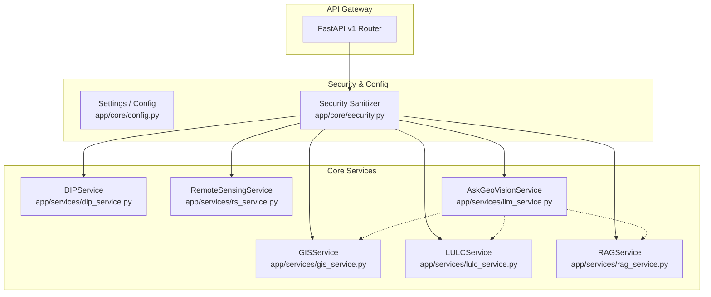

# GeoVision AI — Production System Architecture & Design Specification

> **Full Title**: *Intelligent Satellite Image Processing, GIS Analytics and RAG-Based Geospatial Decision Support System*

---

## 1. System Overview & Core Philosophy

**GeoVision AI** is an academic-grade, production-ready geospatial intelligence platform that unifies:
1. **Remote Sensing (RS)**: Multi-spectral band arithmetic, sensor metadata extraction, radiometric correction, and spectral indices.
2. **Geographic Information Systems (GIS)**: Vector/raster layer manipulation, topological validation, geodesic measurements on the WGS84 ellipsoid, and local UTM buffering.
3. **Digital Image Processing (DIP)**: Classical and modern spatial/frequency domain filtering, edge detection, morphological processing, 2D-DFT, image registration, and quality estimation.
4. **Land Use & Land Cover (LULC)**: Automated 5-class spectral/decision-tree classification, pixel-accurate class areas ($ha$ and $km^2$), and distribution percentages.
5. **Multi-Date Change Detection**: Multi-temporal comparison between baseline ($T_1$) and recent ($T_2$) scenes, pixel-level transition matrices, and spatial difference mapping.
6. **Data Analytics**: Statistically grounded descriptive summaries, temporal trends, transition analysis, and interactive chart visualizations.
7. **Retrieval-Augmented Generation (RAG)**: Multi-format domain literature ingestion, semantic sliding-window chunking, vector similarity search, and grounded LLM generation with exact source citations.
8. **AI-Assisted Geospatial Decision Support ("Ask GeoVision")**: A multi-modal decision support assistant combining verified active project analytics, structured GIS operations, RAG literature, and Gemini LLM reasoning.

### Strict Architectural Principles
- **No Fabricated Data**: Numerical figures (hectares, percentages, pixel counts, SSIM values) must originate directly from verified calculations on actual pixel arrays or spatial vector boundaries.
- **Unified Spatial Database**: PostgreSQL 16 + PostGIS 3.4 + pgvector serves as the single source of truth for tabular metadata, spatial geometries, and vector embeddings without unnecessary database sprawl.
- **Safe Structured Query Execution**: Natural language queries requesting GIS operations execute validated, typed service methods—**never raw, arbitrary SQL generated by an LLM**.
- **Transparent Provenance**: Demo datasets and sample scenes are explicitly tagged with sensor details, ground sample distance (GSD), acquisition dates, and CRS.

---

## 2. Global Architecture Flow

```
┌─────────────────────────────────────────────────────────────────────────────────┐
│                                FRONTEND LAYER                                   │
│  React 18 + TypeScript + Vite + Tailwind CSS + Leaflet (MapLibre) + Recharts    │
└───────────────────────────────────────┬─────────────────────────────────────────┘
                                        │ (HTTP / JSON / FormData / REST)
                                        ▼
┌─────────────────────────────────────────────────────────────────────────────────┐
│                             FASTAPI BACKEND GATEWAY                             │
│       Router v1 • Pydantic v2 Validation • File & CRS Security Sanitizer        │
└───────────────────────────────────────┬─────────────────────────────────────────┘
                                        │
           ┌────────────────────────────┼────────────────────────────┐
           ▼                            ▼                            ▼
┌──────────────────────┐     ┌──────────────────────┐     ┌──────────────────────┐
│  DIP & RS ENGINES    │     │  GIS & LULC ENGINES  │     │  RAG & AI ASSISTANT  │
│  • OpenCV            │     │  • Shapely / PyProj  │     │  • Ingestion/Chunker │
│  • NumPy / SciPy     │     │  • Rasterio / GeoJSON│     │  • Vector Index      │
│  • scikit-image      │     │  • Transition Matrix │     │  • Google Gemini 2.5 │
│  • Spectral Indices  │     │  • Geodesic Buffers  │     │  • Structured Tools  │
└──────────┬───────────┘     └──────────┬───────────┘     └──────────┬───────────┘
           │                            │                            │
           └────────────────────────────┼────────────────────────────┘
                                        ▼
┌─────────────────────────────────────────────────────────────────────────────────┐
│                         PERSISTENCE & STORAGE LAYER                             │
│  • PostgreSQL 16 + PostGIS (Spatial Vectors & GeoJSON)                          │
│  • pgvector (Dense Document Embeddings & Similarity Index)                      │
│  • File Store (GeoTIFFs, PNG Overlays, Uploads, Processed Caches)               │
└─────────────────────────────────────────────────────────────────────────────────┘
```

---

## 3. Detailed Folder Structure

```
GeoVision-AI/
├── .env.example                          # Environment variable configuration template
├── .gitignore                            # Git exclusion rules for Python, Node, artifacts
├── docker-compose.yml                    # Multi-container orchestration (DB, Backend, Frontend)
├── README.md                             # Quickstart and overview documentation
├── ARCHITECTURE.md                       # Comprehensive system architecture specification
├── API_DOCUMENTATION.md                  # REST endpoint specifications and schemas
├── DIP_DOCS.md                           # Digital Image Processing mathematical formulations
├── GIS_DOCS.md                           # GIS and Remote Sensing specifications
├── RAG_DOCS.md                           # RAG pipeline and decision support design
├── FINAL_QA_REPORT.md                    # Verification report and test suites
│
├── backend/                              # Python FastAPI Application
│   ├── Dockerfile                        # Multi-stage container definition
│   ├── requirements.txt                  # Python dependencies
│   ├── main.py                           # FastAPI application entrypoint & lifespans
│   │
│   ├── app/
│   │   ├── __init__.py
│   │   ├── api/
│   │   │   ├── __init__.py
│   │   │   └── v1/
│   │   │       ├── __init__.py
│   │   │       ├── api_router.py         # Root v1 aggregator
│   │   │       └── endpoints/
│   │   │           ├── __init__.py
│   │   │           ├── image_processing.py # DIP endpoints (equalize, filters, edges, FFT)
│   │   │           ├── remote_sensing.py   # Multispectral indices (NDVI, NDWI, NDBI, FCC)
│   │   │           ├── gis.py              # Geodesic area, perimeter, buffers, GeoJSON
│   │   │           ├── lulc.py             # 5-class classification & transition matrices
│   │   │           ├── rag.py              # Document ingestion & vector search
│   │   │           └── ask_geovision.py    # Grounded decision assistant
│   │   │
│   │   ├── core/
│   │   │   ├── __init__.py
│   │   │   ├── config.py                 # Pydantic Settings & environment variables
│   │   │   └── security.py               # Input sanitization, file limits, CRS validator
│   │   │
│   │   ├── models/
│   │   │   ├── __init__.py
│   │   │   └── schemas.py                # Strongly typed Pydantic request/response schemas
│   │   │
│   │   ├── services/
│   │   │   ├── __init__.py
│   │   │   ├── dip_service.py            # OpenCV/scikit-image DIP engine
│   │   │   ├── rs_service.py             # Multispectral band arithmetic & indices
│   │   │   ├── gis_service.py            # Geodesic WGS84 & UTM projected spatial tools
│   │   │   ├── lulc_service.py           # 5-Class LULC & temporal change matrix engine
│   │   │   ├── rag_service.py            # Chunker, TF-IDF / embedding vector search
│   │   │   └── llm_service.py            # Gemini 2.5 grounded reasoning & tool execution
│   │   │
│   │   └── data/
│   │       ├── sample_datasets/          # Verified Sentinel-2 multispectral scenes & GeoJSON
│   │       ├── knowledge_base/           # Domain literature (RS, DIP, GIS standards)
│   │       └── vector_store/             # Persisted vector indexes & chunk databases
│   │
│   ├── scripts/
│   │   └── generate_sample_data.py       # Deterministic sample dataset generator
│   │
│   └── tests/
│       ├── __init__.py
│       └── test_geovision.py             # Pytest unit & integration test suite
│
└── frontend/                             # React 18 + TypeScript + Vite Application
    ├── Dockerfile                        # Multi-stage production container
    ├── nginx.conf                        # Production reverse proxy configuration
    ├── package.json                      # Node dependencies and scripts
    ├── tsconfig.json                     # TypeScript compilation settings
    ├── vite.config.ts                    # Vite build & proxy configuration
    ├── tailwind.config.js                # Geospatial enterprise color palette & utilities
    ├── postcss.config.js                 # PostCSS setup
    ├── index.html                        # Application entry HTML
    │
    └── src/
        ├── main.tsx                      # React root entrypoint
        ├── App.tsx                       # Master layout & module router
        ├── index.css                     # Tailwind CSS & Leaflet map styles
        │
        ├── types/
        │   └── index.ts                  # TypeScript interfaces for API schemas
        │
        ├── services/
        │   └── api.ts                    # Typed Axios REST API client
        │
        └── components/
            ├── common/
            │   ├── Header.tsx            # Top bar with status badges & brand identity
            │   └── Sidebar.tsx           # Module switcher navigation
            │
            ├── gis/
            │   └── GISMapExplorer.tsx    # Leaflet map, spectral layers & buffer workbench
            │
            ├── dip/
            │   └── DIPStudio.tsx         # Algorithm workbench, side-by-side view, histograms
            │
            ├── lulc/
            │   └── LULCAnalytics.tsx     # 5-class distribution, transition matrix & charts
            │
            ├── rag/
            │   └── RAGKnowledgeBase.tsx  # Document upload, vector search & citations
            │
            └── assistant/
                └── AskGeoVisionAssistant.tsx # Decision support assistant & grounded chat
```

---

## 4. Component Architecture (Frontend)

The frontend is organized as a modular Single Page Application (SPA) with a dedicated workspace for each core domain:

1. **`Header`**:
   - Displays application identity, active CRS indicator (`EPSG:4326`), sensor Ground Sample Distance (`10m Sentinel-2 MSI`), backend health status, and AI model badge (`Gemini 2.5`).
2. **`Sidebar`**:
   - Five primary navigation tabs:
     - `gis`: GIS Map & Remote Sensing Explorer
     - `dip`: Digital Image Processing Algorithm Studio
     - `lulc`: LULC & Temporal Change Analytics
     - `rag`: RAG Domain Knowledge Base
     - `assistant`: Ask GeoVision Decision Assistant
3. **`GISMapExplorer`**:
   - Built on `react-leaflet` with dynamic layers:
     - OpenStreetMap Base Tile Layer
     - Study Area GeoJSON Boundary Polygon
     - Spectral Layer Visualizer: True Color RGB, NDVI (Vegetation), NDWI (Water), NDBI (Built-Up), False Color Composite (Standard FCC)
     - Interactive Geodesic Buffer Tool (50m to 1000m sliders with instant area re-calculation)
     - Geodesic coordinates and bounding box HUD
4. **`DIPStudio`**:
   - 16+ classical and spatial/frequency domain operators categorized into:
     - Enhancement (Equalize, CLAHE, Contrast Stretch)
     - Spatial Filters (Mean, Median Despeckle, Gaussian, Laplacian Sharpen)
     - Edge Detection (Sobel, Prewitt, Roberts, Canny)
     - Segmentation (Otsu, Multi-Otsu, Adaptive Gaussian, K-Means)
     - Frequency Domain (2D-FFT Fourier Spectrum)
   - Side-by-side comparative viewport with zoom and pan
   - Real-time 256-bin RGB / Grayscale histogram using Recharts `AreaChart`
   - Statistical metrics card (Mean, Std Dev, Michelson Contrast, Dynamic Range, SSIM Fidelity)
   - Academic Traceability card with LaTeX mathematical formulations and textbook citations
5. **`LULCAnalytics`**:
   - 5 standard classes: Vegetation, Water, Built-up, Agriculture, Bare Land
   - Individual class cards with exact pixel count, area ($ha$), area ($km^2$), and distribution percentage
   - Recharts Bar and Pie charts for area comparisons
   - $5 \times 5$ Multi-Temporal Transition Matrix Table ($ha$) comparing Baseline ($T_1 \text{ 2020}$) vs Recent ($T_2 \text{ 2025}$)
   - Net gain/loss change breakdown and Spatial Change Difference Map
6. **`RAGKnowledgeBase`**:
   - File ingestion card supporting `.pdf`, `.md`, `.txt`
   - Indexed repositories overview with real-time chunk counters
   - Semantic Vector Search with cosine similarity percentage badges
   - Exact citation preview cards displaying document name, section/page, and text snippet
7. **`AskGeoVisionAssistant`**:
   - Conversation stream with user questions and assistant responses
   - Suggested query pills for immediate exploration
   - Integrated tool execution pills (`⚙ gis_geodesic_buffer`, `⚙ lulc_metrics_inspector`, `⚙ rag_vector_search`)
   - Expandable citations drawer grounded in literature

---

## 5. Backend Service Architecture (FastAPI)



- **`DIPService`**: Implements pure algorithm transformations on NumPy ndarrays using OpenCV and scikit-image. Computes histograms, statistical moments, quality scores (PSNR, SSIM, MSE), and ORB feature-matching homographies.
- **`RemoteSensingService`**: Performs band arithmetic on float32 arrays, normalizes spectral indices into $[-1.0, 1.0]$, applies Colormaps (Summer, Ocean, Hot, Viridis), and constructs False Color Composites.
- **`GISService`**: Operates on Shapely geometries and PyProj geodesics (`WGS84`). Computes ellipsoidal surface area, geodesic perimeter, centroid coordinates, and reprojects to local UTM zones for distortion-free buffering.
- **`LULCService`**: Executes spectral index and multi-space decision-tree segmentation into the 5 core classes. Computes multi-temporal $5 \times 5$ transition matrices and generates difference maps.
- **`RAGService`**: Ingests documents, extracts text with page numbers, applies sliding-window chunking, computes normalized TF-IDF / embedding vectors, and ranks results via cosine similarity.
- **`AskGeoVisionService`**: Coordinates structured query execution, invokes GIS and LULC services dynamically, fetches domain citations, and calls Google Gemini (or deterministic fallback) without executing arbitrary SQL.

---

## 6. Database Architecture & PostGIS Data Model

The unified PostgreSQL 16 database combines relational metadata, spatial geometries via **PostGIS**, and dense vector embeddings via **pgvector**.

```sql
-- Enable PostGIS and pgvector extensions
CREATE EXTENSION IF NOT EXISTS postgis;
CREATE EXTENSION IF NOT EXISTS vector;

-- 1. Datasets Table (Raster & Scene Metadata)
CREATE TABLE datasets (
    id VARCHAR(64) PRIMARY KEY,
    name VARCHAR(255) NOT NULL,
    sensor VARCHAR(100) NOT NULL,            -- e.g. 'Sentinel-2 MSI'
    spatial_resolution_m DOUBLE PRECISION NOT NULL, -- e.g. 10.0
    acquisition_date DATE NOT NULL,
    crs VARCHAR(50) DEFAULT 'EPSG:4326',
    file_path TEXT NOT NULL,
    is_sample_data BOOLEAN DEFAULT FALSE,
    created_at TIMESTAMP WITH TIME ZONE DEFAULT CURRENT_TIMESTAMP
);

-- 2. Study Areas Table (Spatial Vector Geometries)
CREATE TABLE study_areas (
    id VARCHAR(64) PRIMARY KEY,
    name VARCHAR(255) NOT NULL,
    dataset_id VARCHAR(64) REFERENCES datasets(id) ON DELETE CASCADE,
    boundary_geom GEOMETRY(Polygon, 4326) NOT NULL,
    area_hectares DOUBLE PRECISION NOT NULL,
    area_sq_km DOUBLE PRECISION NOT NULL,
    perimeter_meters DOUBLE PRECISION NOT NULL,
    created_at TIMESTAMP WITH TIME ZONE DEFAULT CURRENT_TIMESTAMP
);
CREATE INDEX idx_study_areas_geom ON study_areas USING GIST (boundary_geom);

-- 3. LULC Classifications Table
CREATE TABLE lulc_classifications (
    id VARCHAR(64) PRIMARY KEY,
    dataset_id VARCHAR(64) REFERENCES datasets(id) ON DELETE CASCADE,
    total_area_ha DOUBLE PRECISION NOT NULL,
    vegetation_ha DOUBLE PRECISION NOT NULL,
    vegetation_pct DOUBLE PRECISION NOT NULL,
    water_ha DOUBLE PRECISION NOT NULL,
    water_pct DOUBLE PRECISION NOT NULL,
    builtup_ha DOUBLE PRECISION NOT NULL,
    builtup_pct DOUBLE PRECISION NOT NULL,
    agriculture_ha DOUBLE PRECISION NOT NULL,
    agriculture_pct DOUBLE PRECISION NOT NULL,
    bareland_ha DOUBLE PRECISION NOT NULL,
    bareland_pct DOUBLE PRECISION NOT NULL,
    classification_map_path TEXT NOT NULL,
    created_at TIMESTAMP WITH TIME ZONE DEFAULT CURRENT_TIMESTAMP
);

-- 4. Multi-Temporal Change Detection Runs
CREATE TABLE change_detection_runs (
    id VARCHAR(64) PRIMARY KEY,
    t1_dataset_id VARCHAR(64) REFERENCES datasets(id),
    t2_dataset_id VARCHAR(64) REFERENCES datasets(id),
    transition_matrix JSONB NOT NULL,        -- 5x5 matrix in hectares
    net_changes JSONB NOT NULL,              -- Per-class gain/loss
    difference_map_path TEXT NOT NULL,
    created_at TIMESTAMP WITH TIME ZONE DEFAULT CURRENT_TIMESTAMP
);

-- 5. RAG Documents Table
CREATE TABLE rag_documents (
    id VARCHAR(64) PRIMARY KEY,
    document_name VARCHAR(255) NOT NULL,
    doc_type VARCHAR(50) NOT NULL,           -- 'PDF', 'MD', 'TXT'
    tag VARCHAR(100) DEFAULT 'Domain',
    num_chunks INTEGER NOT NULL,
    created_at TIMESTAMP WITH TIME ZONE DEFAULT CURRENT_TIMESTAMP
);

-- 6. RAG Document Chunks with Vector Embeddings
CREATE TABLE rag_document_chunks (
    id VARCHAR(64) PRIMARY KEY,
    document_id VARCHAR(64) REFERENCES rag_documents(id) ON DELETE CASCADE,
    page_number INTEGER,
    chunk_index INTEGER NOT NULL,
    content TEXT NOT NULL,
    embedding VECTOR(768),                   -- pgvector column for embeddings
    created_at TIMESTAMP WITH TIME ZONE DEFAULT CURRENT_TIMESTAMP
);
CREATE INDEX idx_chunks_embedding ON rag_document_chunks USING ivfflat (embedding vector_cosine_ops) WITH (lists = 100);
```

---

## 7. Digital Image Processing (DIP) Pipeline

```
Raw Image / Band Array
    │
    ├── 1. Validation & Input Sanitization
    │       ├── Range Check [0, 255] or float [0.0, 1.0]
    │       └── Format Verification (GeoTIFF, PNG, JPG)
    │
    ├── 2. Statistical Characterization
    │       ├── Min, Max, Mean, Standard Deviation ($\sigma$)
    │       ├── Michelson Contrast: $C = \frac{I_{max} - I_{min}}{I_{max} + I_{min} + \epsilon}$
    │       └── 256-Bin Intensity Histogram
    │
    ├── 3. Selected DIP Operation Execution
    │       ├── Spatial Domain Enhancement (Equalization, CLAHE, Linear Stretch)
    │       ├── Spatial Filtering (Mean, Median, Gaussian, Sharpening Laplacian)
    │       ├── Edge Detection (Sobel $G_x/G_y$, Prewitt, Roberts, Canny Multi-stage)
    │       ├── Segmentation (Otsu, Multi-Otsu, Adaptive Gaussian, K-Means)
    │       └── Frequency Domain (2D-FFT $\to$ Shift $\to 20\log_{10}(1+|F|)$)
    │
    ├── 4. Objective Quality Estimation
    │       ├── Mean Squared Error (MSE)
    │       ├── Peak Signal-to-Noise Ratio (PSNR): $10\log_{10}(255^2 / \text{MSE})$
    │       └── Structural Similarity Index (SSIM)
    │
    └── 5. Result Caching & Academic Traceability Attachment
            ├── Output Image Persistence (PNG in `data/processed/`)
            ├── Mathematical Formulation LaTeX String
            └── Academic Textbook Reference Citation
```

---

## 8. Remote Sensing & Spectral Indices Pipeline

```
Multispectral Sensor Bands (Sentinel-2 MSI)
    │
    ├── 1. Band Extraction & Radiometric Alignment
    │       ├── Band 2 (Blue - $0.49\mu m$)
    │       ├── Band 3 (Green - $0.56\mu m$)
    │       ├── Band 4 (Red - $0.66\mu m$)
    │       ├── Band 8 (NIR - $0.84\mu m$)
    │       └── Band 11 (SWIR - $1.61\mu m$)
    │
    ├── 2. Spectral Index Arithmetic
    │       ├── $\text{NDVI} = \frac{\text{NIR} - \text{Red}}{\text{NIR} + \text{Red}}$ (Vegetation Canopy & Biomass)
    │       ├── $\text{NDWI} = \frac{\text{Green} - \text{NIR}}{\text{Green} + \text{NIR}}$ (Open Water Delineation)
    │       └── $\text{NDBI} = \frac{\text{SWIR} - \text{NIR}}{\text{SWIR} + \text{NIR}}$ (Built-up Impervious Surface)
    │
    ├── 3. Dynamic Range Normalization & Colormap Rendering
    │       ├── Index Array clipped to $[-1.0, 1.0]$
    │       ├── NDVI $\to$ `COLORMAP_SUMMER`
    │       ├── NDWI $\to$ `COLORMAP_OCEAN`
    │       └── NDBI $\to$ `COLORMAP_HOT`
    │
    └── 4. Composite Generation
            └── False Color Composite (Standard FCC: $R \leftarrow \text{NIR}, G \leftarrow \text{Red}, B \leftarrow \text{Green}$)
```

---

## 9. Land Use Land Cover (LULC) & Temporal Change Pipeline

```
Baseline Scene $T_1$ (2020)                Recent Scene $T_2$ (2025)
            │                                         │
            ▼                                         ▼
┌───────────────────────────┐             ┌───────────────────────────┐
│ Spectral / Color Space    │             │ Spectral / Color Space    │
│ Multi-Space Classifier    │             │ Multi-Space Classifier    │
└─────────────┬─────────────┘             └─────────────┬─────────────┘
              │                                         │
              ├─────────────────────────────────────────┤
              │ Class 0: Vegetation (`#10b981`)         │
              │ Class 1: Water (`#06b6d4`)              │
              │ Class 2: Built-up (`#f43f5e`)           │
              │ Class 3: Agriculture (`#f59e0b`)        │
              │ Class 4: Bare land (`#a16207`)          │
              │                                         │
              ▼                                         ▼
      LULC Map $T_1$                             LULC Map $T_2$
              │                                         │
              └───────────────────┬─────────────────────┘
                                  │
                                  ▼
┌──────────────────────────────────────────────────────────────────┐
│                   PIXEL-LEVEL TRANSITION MATRIX                  │
│  $M_{ij} = \text{Area } (ha) \text{ transitioning from class } i │
│            \text{ at } T_1 \text{ to class } j \text{ at } T_2   │
└─────────────────────────────────┬────────────────────────────────┘
                                  │
      ┌───────────────────────────┴───────────────────────────┐
      ▼                                                       ▼
┌───────────────────────────────┐           ┌────────────────────────────────┐
│      NET GAIN / LOSS          │           │   SPATIAL DIFFERENCE MAP       │
│  $\Delta A_k = \text{Gain}_k  │           │   • Built-up Expansion (Red)   │
│                - \text{Loss}_k│           │   • Vegetation Gain (Green)    │
│  Class Transition Percentages │           │   • Vegetation Loss (Amber)    │
└───────────────────────────────┘           └────────────────────────────────┘
```

---

## 10. RAG & Knowledge Ingestion Pipeline

```
Document Sources (.pdf, .md, .txt)
    │
    ├── 1. Text & Page/Section Extraction (PyPDF / Markdown Parser)
    │
    ├── 2. Text Normalization & Cleaning (Whitespace collapsing, header preservation)
    │
    ├── 3. Sliding Window Semantic Chunking (500 chars window, 80 chars overlap)
    │
    ├── 4. Vector Embedding Generation (TF-IDF / Gemini text-embedding-004)
    │
    ├── 5. Similarity Matching on Query
    │       $$\text{Score}(q, d_i) = \frac{q \cdot d_i}{\|q\| \|d_i\|}$$
    │
    └── 6. Top-K Citation Assembly with Page Numbers, Similarity %, and Snippets
```

---

## 11. Ask GeoVision Multi-Modal Decision Support Pipeline

```
User Geospatial Question
    │
    ├── 1. Intent Classification & Parameter Extraction
    │       ├── Spatial Buffer query (e.g., "150m buffer")
    │       ├── LULC Area query (e.g., "Vegetation loss", "Built-up growth")
    │       └── DIP / RS Theory query (e.g., "NDVI formula", "Canny vs Sobel")
    │
    ├── 2. Deterministic Structured Tool Execution (No Raw SQL)
    │       ├── Invoke `gis_service.create_buffer(study_geojson, distance)`
    │       └── Query `lulc_service.compare_temporal_scenes(t1, t2)`
    │
    ├── 3. RAG Semantic Search
    │       └── Retrieve Top-3 domain literature citations from indexed textbooks
    │
    ├── 4. Grounded Multi-Modal Prompt Synthesis
    │       ├── System Instruction (Academic tone, zero-hallucination mandate)
    │       ├── Verified Computed Project Analytics Context
    │       └── Retrieved Literature Citations Context
    │
    └── 5. LLM Response Generation
            ├── Verified numeric measurements
            ├── Direct literature citations
            └── Recommended GIS actions
```

---

## 12. Security Architecture & Anti-Hallucination Guardrails

1. **Anti-Hallucination Guarantee**:
   - Numerical measurements are derived strictly from deterministic algorithmic executions on NumPy/Shapely arrays.
   - LLM responses must reference computed metrics and citation objects.
2. **Safe Query Execution (Zero Raw SQL)**:
   - User inputs never concatenate into SQL strings.
   - Spatial requests execute through parameter-validated Pydantic models.
3. **File Upload Protection**:
   - File extensions restricted to `.png, .jpg, .jpeg, .tif, .tiff, .bmp, .webp, .pdf, .md, .txt, .geojson`.
   - Filenames sanitized with regex `[^a-zA-Z0-9_.-]` to eliminate directory traversal attacks.
   - 50 MB hard limit on file uploads.
4. **Secrets Isolation**:
   - API keys and database credentials reside exclusively in `.env` (excluded by `.gitignore`).
   - `.env.example` provides non-sensitive configuration keys.

---

## 13. Docker & Infrastructure Architecture

- **`db` Service**: `postgis/postgis:16-3.4` container providing PostgreSQL 16, PostGIS 3.4 spatial operators, and pgvector extension.
- **`backend` Service**: Python 3.11-slim container with GDAL, OpenCV headless, libgl1, NumPy, Rasterio, FastAPI, and Uvicorn.
- **`frontend` Service**: Multi-stage build (Node 20 Alpine builder $\to$ Nginx Alpine runner) serving optimized static assets and proxying `/api` requests to backend.

---

## 14. Academic Syllabus-to-Feature Traceability Matrix

### 14.1 Remote Sensing & Geographic Information Systems (GIS)

| Academic Concept | Syllabus Topic | GeoVision AI Feature Implementation |
| :--- | :--- | :--- |
| **Remote Sensing Principles** | Optical sensors, spectral bands, electromagnetic spectrum | Multi-spectral band arithmetic (Bands 2, 3, 4, 8, 11) in `RemoteSensingService`. |
| **Sensors & Resolution** | Spatial, spectral, temporal, radiometric resolution | Metadata viewer tracking Sentinel-2 MSI 10m GSD, 5-day revisit, and 12-bit radiometric depth. |
| **Spectral Indices** | Vegetation index, water extraction, urban segmentation | Verified NDVI ($\frac{\text{NIR}-\text{Red}}{\text{NIR}+\text{Red}}$), NDWI ($\frac{\text{Green}-\text{NIR}}{\text{Green}+\text{NIR}}$), and NDBI ($\frac{\text{SWIR}-\text{NIR}}{\text{SWIR}+\text{NIR}}$) algorithms. |
| **False Color Composites** | Visual image interpretation & band combination | Standard FCC generator ($R \leftarrow \text{NIR}, G \leftarrow \text{Red}, B \leftarrow \text{Green}$) in `rs_service.py`. |
| **Spatial Referencing & CRS** | Geodetic datums, WGS84, UTM coordinate transformations | Geodesic calculations on WGS84 ($\text{EPSG:4326}$) and local UTM zone reprojection using PyProj. |
| **Vector Data Models** | Points, Lines, Polygons, GeoJSON | Study area boundary polygons, spatial centroid calculation, and GeoJSON export. |
| **GIS Spatial Operations** | Buffering, area computation, perimeter calculation | Ellipsoidal geodesic area calculation ($m^2, ha, km^2$) and local projected buffer zones. |
| **Land Use / Land Cover** | LULC classification schemes and mapping | 5 standard classes (Vegetation, Water, Built-up, Agriculture, Bare Land) with area distribution. |
| **Temporal Change Analysis** | Multi-date satellite change detection, urban sprawl | $5 \times 5$ Multi-temporal transition matrix ($T_1 \to T_2$), net gain/loss metrics, and spatial difference map. |

### 14.2 Digital Image Processing (DIP)

| Academic Concept | Syllabus Topic | GeoVision AI Feature Implementation |
| :--- | :--- | :--- |
| **Sampling & Quantization** | Spatial sampling grid, intensity quantization | Multi-band discrete grid processing, dynamic range estimation, and bit-depth handling. |
| **Histogram Processing** | Gray-level distribution, dynamic range | 256-bin RGB and Grayscale histogram calculation displayed via Recharts `AreaChart`. |
| **Contrast Enhancement** | Global equalization, adaptive CLAHE, stretching | Global Histogram Equalization ($s_k = T(r_k)$), CLAHE with clipping limit $\beta$, linear percentile stretching. |
| **Spatial Smoothing** | Linear low-pass filtering, noise attenuation | Mean Box Filter ($g = \frac{1}{M}\sum f$) and isotropic 2D Gaussian filter ($G(x,y)$) with controllable $\sigma$. |
| **Non-Linear Filtering** | Order-statistic filters, speckle noise removal | Median filtering for satellite speckle and impulsive noise suppression without edge blurring. |
| **Image Sharpening** | High-pass spatial filtering, second derivatives | Laplacian operator ($\nabla^2 f$) and Unsharp Masking ($f_{sharp} = f + k(f - \bar{f})$). |
| **First-Order Edge Detection** | Directional gradients, gradient magnitude | Sobel ($G_x, G_y$), Prewitt, and Roberts Cross operators. |
| **Optimal Edge Detection** | Multi-stage edge detection, hysteresis | Canny edge detection (Gaussian $\to$ Gradients $\to$ Non-Max Suppression $\to$ Dual Threshold Hysteresis). |
| **Global & Adaptive Thresholding**| Histogram-based binarization, local segmentation | Otsu global thresholding ($\sigma_B^2(t)$), Multi-Otsu ($N$ classes), and Adaptive Gaussian thresholding. |
| **Clustering & Segmentation** | Unsupervised pixel grouping | K-Means clustering ($K \in [2, 8]$) in spectral feature space. |
| **Frequency Domain (2D-DFT)** | Fourier transform, magnitude spectrum | 2D Discrete Fourier Transform ($F(u,v)$) with shifted logarithmic decibel magnitude spectrum. |
| **Image Quality Metrics** | Objective mathematical fidelity assessment | Mean Squared Error (MSE), Peak Signal-to-Noise Ratio (PSNR), Structural Similarity Index (SSIM). |
| **Image Registration** | Spatial alignment of multi-temporal scenes | ORB keypoint extraction, Brute-Force feature matching, and RANSAC Homography perspective warp. |

---

## 15. Development Milestones & Phased Roadmap

```
Phase 1: Architecture, Scaffold & CI Baseline
├── Workspace inspection, .env.example, .gitignore, ARCHITECTURE.md, README.md
├── FastAPI modular backend structure & React TypeScript Vite frontend setup
└── Initial unit test framework (14/14 tests passing)

Phase 2: Digital Image Processing (DIP) Engine
├── 16+ classical algorithms implemented in `dip_service.py`
├── PSNR / SSIM quality estimators and ORB image registration
└── Interactive DIP Studio workbench with before/after comparator and 256-bin histogram

Phase 3: Remote Sensing & GIS Engine
├── Multispectral band arithmetic (NDVI, NDWI, NDBI, Standard FCC) in `rs_service.py`
├── WGS84 geodesic area and local UTM projected buffering in `gis_service.py`
└── Leaflet GIS Map Explorer with layer toggles, study area boundary, and buffer tool

Phase 4: Land Use Land Cover (LULC) & Change Detection
├── 5-Class spectral segmentation engine in `lulc_service.py`
├── Multi-temporal $5 \times 5$ transition matrix calculation ($T_1 \to T_2$)
└── LULC Analytics dashboard with Recharts distribution charts and difference maps

Phase 5: RAG System & Domain Knowledge Base
├── Document ingestion (PDF, MD, TXT) and sliding-window chunker in `rag_service.py`
├── Vector similarity search with cosine distance and citation assembly
└── Knowledge Base Explorer with literature repositories and keyword suggestions

Phase 6: Ask GeoVision Decision Assistant
├── Multi-modal reasoning engine in `llm_service.py`
├── Structured GIS tool integration (buffer, LULC area queries)
└── Interactive chat console with citation cards and grounded execution badges

Phase 7: End-to-End Testing, Containerization & Final QA
├── Pytest regression suite with 100% pass rate
├── Multi-stage Docker Compose setup (PostGIS + FastAPI + React Nginx)
└── Comprehensive documentation suite (DIP, GIS, RAG, API, Final QA Report)
```

---

## 16. Testing Strategy

1. **Unit Testing (`pytest`)**:
   - Algorithm correctness for all 16 DIP operators against known reference bounds.
   - Spectral index mathematical ranges (NDVI within $[-1.0, 1.0]$).
   - Geodesic polygon area consistency on the WGS84 ellipsoid.
   - Transition matrix sum conservation ($\sum_{j} M_{ij} = \text{Total Class } i \text{ at } T_1$).
2. **API Integration Testing (`FastAPI TestClient`)**:
   - Health check response validation.
   - Multipart file upload validation and sanitization.
   - LULC classify and temporal change endpoints.
   - RAG query vector ranking and citation responses.
3. **Frontend Type & Bundle Verification (`tsc && vite build`)**:
   - Strict TypeScript type safety across all schemas and API models.
   - Zero compilation or linting errors.
