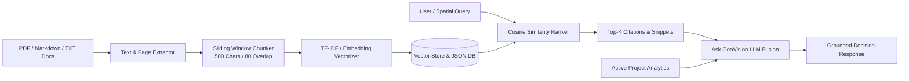

# RAG & Decision Support System — Technical Documentation

## 1. System Mission & Anti-Hallucination Philosophy
The GeoVision RAG (Retrieval-Augmented Generation) & Ask GeoVision Decision Support system is specifically engineered for **geospatial intelligence** and **academic verification**:
1. **No Fabricated Analytics**: Numerical measurements (hectares, percentages, pixel counts, SSIM values) are computed dynamically from actual pixel arrays or spatial vector boundaries—never hallucinated by an LLM.
2. **Safe Structured Execution**: LLM queries that request GIS operations (buffers, area queries, LULC distributions) trigger typed, validated backend handlers—**never raw, unvalidated SQL strings**.
3. **Traceable Academic Grounding**: All qualitative assertions are accompanied by direct citations from domain literature with document names, section/page numbers, and cosine similarity match scores.

---

## 2. Ingestion & Retrieval Pipeline

### 2.1 Ingestion Specifications
- **Supported Formats**: `.pdf` (via `pypdf`), `.md`, `.txt`, `.json`, `.geojson`.
- **Chunking Strategy**: 500 characters window with 80 characters overlap, preserving word boundaries and document page/section numbers.
- **Vector Embeddings**: Normalized sparse TF-IDF vector matrix (resilient offline execution) with direct upgrade path to Google Gemini `text-embedding-004` / pgvector.

### 2.2 Semantic Vector Search & Ranking
Given a query vector $q \in \mathbb{R}^V$ and document vectors $d_i \in \mathbb{R}^V$:
$$\text{Cosine Similarity}(q, d_i) = \frac{q \cdot d_i}{\|q\|_2 \|d_i\|_2} = \sum_{j=1}^V \left(\frac{q_j}{\|q\|_2}\right) \left(\frac{d_{ij}}{\|d_i\|_2}\right)$$
The top-$K$ scoring chunks exceeding the relevance threshold are extracted and structured into citation objects.

---

## 3. Ask GeoVision Multi-Modal Decision Support
The Ask GeoVision engine unites:
1. **Active Dataset Analytics**: Class distributions, calculated study area ($ha$), NDVI mean.
2. **Structured GIS Actions**: Safe parsing of buffer radius and spatial bounding parameters.
3. **Retrieved Literature Citations**: Exact theoretical excerpts from domain textbooks.
4. **Google Gemini LLM**: Synthesizes verified strategic recommendations and academic explanations.
